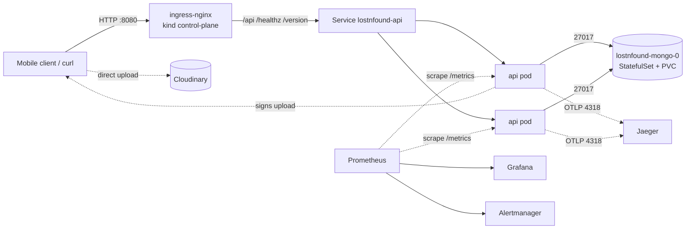

# Design decisions and trade-offs

Each section: what was chosen, why it fits this app, the credible alternative,
and when the alternative would be the better call.

## Architecture and request path

- **Request path:** client → ingress-nginx (host `lostnfound.localtest.me`) →
  ClusterIP Service → one of ≥2 API pods → MongoDB through the headless Service
  `lostnfound-mongo-0.lostnfound-mongo`. DNS resolves via CoreDNS; kube-proxy
  load-balances the Service.
- **Image uploads never pass through the cluster.** The API only signs a Cloudinary
  upload (`/api/upload/sign`); the device uploads directly. So Cloudinary being
  down affects images only, not posting/browsing, and the API needs no internet egress.
- **Failure boundaries:**
  | Failure | Effect | Contained by |
  |---|---|---|
  | One API pod crashes | Others keep serving | 2+ replicas, topology spread, PDB, readiness |
  | MongoDB down | API returns 503 fast; no restart storm | readiness checks DB, liveness does not |
  | Bad release | Old pods keep serving | `maxUnavailable: 0` + `--rollback-on-failure` |
  | Jaeger down | Traces dropped, requests unaffected | OTel exporter is async/batched |
  | Prometheus down | No alerts; app unaffected | out of request path |
  | Node lost (kind worker) | API rescheduled; Mongo waits for its volume | local-path PV is node-bound (limitation) |

## Kubernetes

- **API = Deployment.** Stateless (JWT, no sessions), so pods are interchangeable.
  2 replicas minimum so one can be lost or rolled without downtime; HPA to 5 on
  CPU 70% because bcrypt hashing on login/register is the CPU hot path.
- **MongoDB = StatefulSet with a volumeClaimTemplate**, 1 replica. Stable name for
  the connection string and a PVC that survives pod deletion (demonstrated in
  `docs/evidence/fault-mongodb-outage.txt`). *Alternative:* a 3-member replica set
  (or the Bitnami/Percona operator) for HA and zero-downtime DB maintenance — the
  right call for real users; overkill for a laptop where all members would share one disk anyway.
  *Alternative:* managed MongoDB Atlas — removes the stateful workload entirely; chosen against to keep everything local and free.
- **Probes:** `startupProbe` (/healthz) protects slow starts; `livenessProbe`
  (/healthz) only checks the event loop answers, so a DB outage never restarts pods;
  `readinessProbe` (/readyz) checks the Mongo connection, so unready pods leave the Service.
  Mongo probes run `mongosh ping`.
- **Graceful rollouts:** `preStop` sleep 5s lets ingress drop the endpoint, then
  SIGTERM triggers `server.close()` to drain in-flight requests (`server.js`).
  Node runs as PID 1 directly (not via `npm start`) so it actually receives SIGTERM.
- **Resources:** API requests 50m/128Mi, limit 500m/256Mi (measured idle ~60Mi;
  headroom for bcrypt bursts). Mongo 100m/256Mi → 1/512Mi. Requests make
  scheduling and HPA percentages meaningful; memory limits stop a leak taking a node.
- **Placement:** `topologySpreadConstraints` across hostnames (soft) so the two
  API pods land on different workers; PDB `minAvailable: 1` keeps one during drains.

## Deployment configuration

- **One Helm chart** (`deploy/helm/lostnfound`), defaults = local kind env; a small
  override file per environment (`values-ci.yaml` for the ephemeral CI cluster).
  No copied manifests to drift apart. *Alternative:* Kustomize base+overlays — equally
  good; Helm chosen for release history/rollback and `helm test`.
- **Config vs secrets:** non-sensitive settings in a ConfigMap; a checksum annotation
  on the pod template rolls pods when it changes (env is read only at start).
  Secrets are referenced by name (`existingSecret`) and created out-of-band.
- **Platform add-ons** (ingress-nginx, metrics-server, kube-prometheus-stack, Jaeger)
  are installed by `scripts/cluster-up.sh` with pinned versions, so the cluster is reproducible.

## CI/CD

Pipeline (`.github/workflows/ci.yml`), on every PR and push to `main`:

1. `test` — `npm ci`, ESLint, API tests (node:test + supertest + in-memory MongoDB), `npm audit --omit=dev --audit-level=high`.
2. `secrets` — gitleaks over the full git history.
3. `chart` — `helm lint` (both value sets) + Trivy misconfiguration scan of chart and Dockerfile.
4. `image` — build once, tag with the **7-char commit SHA**, Trivy image scan
   (fail on fixable HIGH/CRITICAL), push to GHCR.
5. `deploy-test` — spin up kind inside the runner, load that exact image, `helm upgrade --install --rollback-on-failure`, run `helm test` (registers, posts an item, lists it, asserts `/version` equals the SHA).

**CD boundary — why the last step is a human running `scripts/deploy.sh <sha>`:**
the target cluster is kind on a laptop, which GitHub-hosted runners cannot reach.
Options were (a) a self-hosted runner on the laptop — exposes the machine to
workflow code from PRs; (b) Argo CD pulling from Git — the right answer for a
reachable or long-lived cluster, but adds a controller and a GitOps repo for a
single environment; (c) a gated pull-based script. I chose (c): `deploy.sh`
refuses any commit whose CI run did not succeed (checked with `gh run list`),
pulls the immutable SHA image CI built and scanned, and deploys atomically.
The human running it *is* the approval step. With a cloud cluster I would move
to Argo CD watching `main` with the image tag committed by CI.

**Traceability:** commit → image tag `ghcr.io/kkartikay-27/lostnfound-api:<sha7>`
(OCI `revision` label) → Helm revision description `deploy <sha7>` → pod label
`app.kubernetes.io/version` → `/version` endpoint and `lostnfound_build_info{commit}` metric (shown on the dashboard).

## Release control

- **Rolling update, `maxSurge: 1, maxUnavailable: 0`.** A new pod must be ready
  before an old one goes, so a broken build stalls instead of serving.
  `--rollback-on-failure` reverts automatically if the rollout isn't healthy in time.
  Evidence: a deliberately crashing build rolled back with 445/445 live requests succeeding.
- **Manual rollback:** `helm rollback lostnfound <rev>`; `helm history` shows what ran when.
- **Feature flag** `FEATURE_ITEM_SEARCH` (ConfigMap) ships search dark and acts as a kill switch without a rebuild.
- *Why not blue-green/canary:* with 2 replicas and no traffic-splitting layer
  (no service mesh / Argo Rollouts), a canary is effectively 50% of traffic. Rolling +
  readiness + flags covers the risks here. With real traffic I would add Argo
  Rollouts canary steps gated on the error-rate SLO query.
- **Drift:** everything goes through Helm; `helm get values` / `helm diff`
  shows intended state. A manual `kubectl edit` would be overwritten on the next deploy.
  (GitOps with self-heal would detect drift continuously — a reason to adopt Argo CD later.)
- **Data migrations:** Mongoose schemas are additive; a breaking schema change would
  need expand/contract so rollback stays safe.

## Observability and reliability

- **Metrics** (prom-client): `http_request_duration_seconds` histogram labelled by
  *route template* (bounded cardinality), Node runtime metrics, business counters
  (`lostnfound_items_created_total`, `lostnfound_auth_attempts_total`), build info.
- **Logs:** pino JSON to stdout, one line per request with request id and
  `trace_id`; Authorization headers and password fields redacted. Read with
  `kubectl logs`. *Limitation:* no central log store (Loki would be next).
- **Traces:** OpenTelemetry auto-instrumentation (HTTP, Express, MongoDB) → OTLP → Jaeger,
  so a slow request can be split into middleware vs Mongo time. Probe/scrape
  requests are excluded.
- **What "healthy" means (SLOs):**
  - Availability: ≥ 99% of `/api` requests are non-5xx (error budget 1%).
  - Latency: p95 of `/api` requests < 500 ms.
  - User success: the `helm test` / `scripts/smoke.sh` journey (register → post → list) passes.
- **Alerts → actions** (PrometheusRule, each links to `docs/RUNBOOK.md`):
  multi-window error-budget burn (14.4× over 1h and 5m), p95 latency, no available
  API pods, MongoDB not ready, API restart loop.

## Security

- **Secrets:** none in Git (gitleaks in CI). Generated per cluster by
  `scripts/create-secrets.sh` into a Kubernetes Secret; injected as env vars
  via `secretKeyRef`. *Limitation:* Kubernetes Secrets are base64 in etcd; next
  step is Sealed Secrets or External Secrets + a vault, and etcd encryption at rest.
- **Runtime:** non-root UIDs, `readOnlyRootFilesystem`, all capabilities dropped,
  no privilege escalation, seccomp `RuntimeDefault`, no ServiceAccount token mounted
  (neither workload calls the Kubernetes API). npm/yarn removed from the runtime image.
- **Network:** default-deny NetworkPolicy; only ingress-nginx and Prometheus can
  reach the API, only the API can reach Mongo, API egress limited to Mongo, DNS and Jaeger.
  Only `/api`, `/healthz`, `/version` are routed by the ingress — `/metrics` and Mongo are internal.
  Enforcement verified: the helm test pod was blocked until given an explicit egress rule.
- **App:** helmet headers, rate-limited login/register, request size limit,
  query coercion fixing a NoSQL operator-injection path (`?type[$ne]=`) that crashed the baseline.
- **Delivery:** least-privilege `GITHUB_TOKEN` (`contents: read`, `packages: write`
  only on the image job), actions pinned to commit SHAs and scanner images to digests,
  `npm audit`, Trivy image + config scans, PRs from forks cannot push images.
- **Exposure:** the ingress listens on 127.0.0.1 only. *Limitation:* plain HTTP
  locally; in a real environment, TLS via cert-manager at the ingress.
